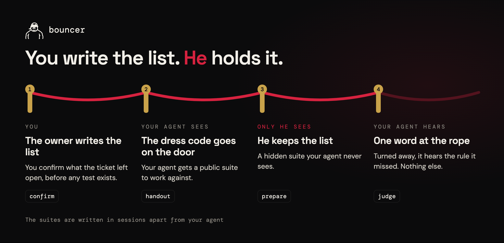

# Bouncer: the full reference

The contract behind the [README](../README.md): what it covers, every
measurement, real catches, how it compares, the FAQ, the pipeline, install, the optional platform sign-in, CI, how
the hidden suite is kept honest, scope and the file layout. Steps as the
skill runs them: [skills/bouncer/SKILL.md](../skills/bouncer/SKILL.md).

## What it is

**Hidden, calibrated test suites for AI coding agents, independent of the agent
they judge.** An agent skill and CLI, for Claude Code, Codex, Cursor and other
agents, that turns a ticket or spec for one module in TypeScript, Python, Go or
Rust, for a command or an HTTP service checked only at that boundary, or for a
change to one package of an existing TypeScript or Python repository, into a
**public** test suite the implementing agent works against and a **hidden**
suite, which the agent never sees, that judges the result. A writer model (Opus
5.5 through Claude Code, or Codex or the Anthropic API without it) writes both
suites and the reference that calibrates them, in sessions apart from the
implementing agent. A person confirms the spec's decisions before any test is
written. The implementing agent can be anything that edits a folder: Claude
Code, Codex, Cursor, Copilot, Aider, or a person.

Use it when "all tests pass" comes from the same agent that wrote the tests, and
you want acceptance decided by tests it could not have overfitted, gamed or
guessed.

## Before any spec: the door and the ID check

- `bouncer door [--transcript <file>] [--repo <dir>]`: no model, seconds. Reads
  the agent's session transcript and, in a TypeScript checkout with carveout
  installed, `carveout gate`; lists no test run after the last edit, tests
  skipped, weakened or deleted, the last test run red, only tests the agent
  wrote, a TODO in code, harness or config edited. It reports and never
  blocks: on 127 real sessions that claimed done any rule fired on 8.7%,
  under the 10% its gate asked for, and a model-judged check upheld 1 of 50
  firings ([DOOR.md](../evidence/DOOR.md)).
- `bouncer id [<slug>] [--ticket <file>] [--diff <file> | --repo <dir> --base <ref>]`
  (the ticket is `--ticket`, else `specs/<slug>/ticket.md`):
  one Sonnet 5.5 session, a median $0.06 and 17 s. What the ticket never said and
  what the diff picked, each with the ticket sentence, where, and the usual
  alternative. Questions, never ranked: the person's keep or change becomes a
  `Decided:` line.
- `bouncer check [--from <issue> | --ticket <file>] [--base <ref>] [--package <dir>] [--seam <file>[,<file>]] [--slug <slug>] [--new] [--accept-open] [--card <file.svg>] [--no-door]`:
  the whole after-the-fact flow in one command. Door, base and package from
  the change, fit, the ID check, a drafted `spec.md` with each pick as a
  `Decided:` item; exit 3 until the person confirms; run again to prepare
  and judge the working tree. A rerun resumes the newest check on that
  checkout and branch and says which; `--new` starts another, and a flag
  that differs from the resumed check is refused. Exit: the judge's code once
  judged; before that 1 nothing to check or a step failed, 2 out of scope or
  `fit` unsupported (with a ticket, after the ID list of the whole change), 3 the person must confirm, 4 `prepare`'s open questions. The steps by hand are
  [skills/bouncer/references/check.md](../skills/bouncer/references/check.md).

## The numbers

About 3,000 graded agent runs on 26 TypeScript specs, 40 LiveCodeBench problems,
40 HumanEval+ tasks and a spec ladder judged by oracles no model wrote, 11 real
commits replayed inside their repository and 12 more in two public repositories
(unjs/ufo, unjs/pathe). Opus 5.5 wrote the suites, Haiku 5.5 implemented unless
stated; Codex CLI as the writer and the referee is in RESULTS.md "Writer
backends", as an implementer in "Other implementers", and Opus 5.5 as an
adversary in "Red team". Every table, with Fisher's exact p-values, is in
[RESULTS.md](../RESULTS.md).

| question                                      | measured                                                                                                                                                                                                                                                                                     |
| --------------------------------------------- | -------------------------------------------------------------------------------------------------------------------------------------------------------------------------------------------------------------------------------------------------------------------------------------------- |
| Agent's own tests green, hidden suite rejects | 75 of 105 runs from a loose ticket (71%); 25 of 404 from a precise spec (6%)                                                                                                                                                                                                                 |
| Were those rejections right?                  | A blind referee on another model, given the spec, the code and one anonymised test, upheld 95 of 100; Codex as the referee, also 95 of 100                                                                                                                                                   |
| Does giving the agent a public suite help?    | From a ticket, 81 of 105 pass the hidden suite, against 30 of 105 without: better on 5 of 7 tickets, worse on none (paired t over tickets, p = 0.02). The same decisions as prose, no tests: 80 of 105                                                                                       |
| Does a stronger agent need it less?           | Not much. From the ticket alone Opus 5.5 passed 15 of 35, Sonnet 5.5 16, Haiku 9 (Opus against Haiku p = 0.21), every run with its own tests green; with the public suite 26, 25 and 26                                                                                                      |
| Judged by tests nobody here wrote?            | On 11 ufo and pathe commits, by the maintainers' own tests: 151 of 152 runs from a confirmed spec pass every one, 95 of 110 from the ticket alone; the specs were confirmed by a session shown the real diff                                                                                 |
| How often is a pass wrong?                    | Judged again by Codex's suites and refereed blind, 51 of 386 public-suite passes miss a rule the spec requires; 48 of the 51 are on three specs, 22 rest on one ruling. Sonnet's second suites catch 0 of 13 of them, Codex's 13                                                             |
| Does the hidden suite resist gaming?          | Haiku: 21 of 21 gamed submissions rejected (20 hard-coded its inputs). Opus 5.5 on the 4 specs mutants survive most: 20 of 20 rejected on two, 0 of 20 on the other two, where an audit finds a skipped rule in 18                                                                           |
| False rejects, against an outside oracle      | 3 of 289 correct HumanEval+ solutions, or 23 of 314 counting two tasks the suite read differently from the oracle (one holds a `-> int` function to returning an int); wrong ones accepted 4.8% vs 15.0% by HumanEval's own tests                                                            |
| Does it depend on Claude writing the suites?  | Codex CLI wrote the 26 specs' suites: 99.4% of its hidden tests survive calibration on Claude's reference, and both suites kill 80.6% of 1,442 mutants against Claude's 79.2%; on EvalPlus they accept 3.8% of wrong solutions against 4.8%                                                  |
| Agreement with a real tool                    | The calibrated reference matched `git apply` on all 7,533 real-history cases judged                                                                                                                                                                                                          |
| Judged through a command or a service         | patch-apply as `node src/cli.js`: the same 79 hidden tests kept, the same verdict on 196 of 196 stored submissions, `git apply`'s answer on 7,533 of 7,533 judged cases. As an HTTP service (csv-export): a 501 stub `incomplete`; blind Haiku passed 2 of 5, the other 3 fail one real rule |
| The same in Python, Go and Rust               | Both specs ported: every hidden test kept on each language's reference; patch-apply matches `git apply` on 7,533 of 7,533 in each; blind Haiku passed 16 of 18: a real defect, and a JavaScript reading in the suite                                                                         |
| Go and Rust modules                           | duration-parse prepared in each: 159 and 110 hidden tests kept; 6 of 6 blind Haiku runs passed                                                                                                                                                                                               |
| Feedback that leaks no test                   | Retry told only the failing scenario keys recovers 75 of 92; told "failed", 57 of 96 (p = 0.001)                                                                                                                                                                                             |
| Real commits, judged inside their repository  | 11 commits replayed: 8 of 11 pass suites from a confirmed spec, 0 of 11 from a spec drafted from the commit message; on unjs/ufo and unjs/pathe, 12 of 12 and 3 of 12                                                                                                                        |
| Did those suites find anything real?          | 2 of the 6 hidden tests the confirmed commits fail are defects in the shipped code; 2 read an open question                                                                                                                                                                                  |
| Is the drafted decision the one confirmed?    | 165 of 243 drafted defaults kept (68%), 59% against real code; 2 of 18 drafts needed no change                                                                                                                                                                                               |
| Judged in CI from a sealed suite              | The 11 commits judged by the workflow's script from seals, locally: same 8 of 11 and 0 of 11, 0 hidden test names in 66 logs and checks                                                                                                                                                      |
| Agents inside a repository                    | Haiku passed 110 of 110 runs on 11 confirmed specs, and 109 of 110 on ufo and pathe; Codex CLI 25 of 25 on ufo and 17 of 17 on pathe; 0 broke an existing test, 0 changed code outside the allowed paths                                                                                     |
| Did any agent tamper with tests or harness?   | 0 of 2,522 sandboxed Haiku runs, 0 of 50 Codex CLI runs, 0 of 40 Opus runs told to game; 0 of 262 in a repository (Haiku and Codex)                                                                                                                                                          |
| Cost per spec                                 | $1–4 on Opus 5.5 (median $2) and 10–25 minutes, plus the person's confirmation (median minutes pending); an agent run is cents on Haiku 5.5                                                                                                                                                  |

## Real catches

Every one of these passed every test it could see. None was on the list.

- **Shipped code, in a real commit.** A priority named `constructor` ranked as
  a function instead of `"high"`; `categories` looks names up in a plain
  object. The confirmed spec said otherwise
  ([In an existing repository](../RESULTS.md#in-an-existing-repository)).
- **An HTTP service.** Three of five blind runs accepted a status sent as
  `["open"]`: `Object.hasOwn(labels, status)` turns the array into the string
  `"open"`. Told only the scenario key, the first retry passed 48/48
  ([Black-box seams](../RESULTS.md#black-box-seams)).
- **A Rust port.** Creation times cut to whole milliseconds, so two records
  0.1 ms apart sorted by id
  ([Commands and services in other languages](../RESULTS.md#commands-and-services-in-other-languages)).
- **And one against us.** A Go run read `1e400` as the integer 10^400, which
  the spec allows; the hidden test expected JavaScript's reading. The overfit
  was the judge's, and RESULTS.md says so.

## How it compares

| approach                     | who writes the tests that decide "done"                 | how it fits                                                                   |
| ---------------------------- | ------------------------------------------------------- | ----------------------------------------------------------------------------- |
| Ask the agent to write tests | the agent that wrote the code                           | what this replaces: 75 of 105 green runs from loose tickets were wrong        |
| TDD enforcement              | the agent, test first                                   | complementary: it fixes the order; Bouncer changes the author                 |
| AI code review               | nobody: a model reads the diff                          | complementary: review reads the code, Bouncer runs it against the spec        |
| Spec-driven toolkits         | usually the implementing agent                          | complementary: they turn a spec into tasks, Bouncer into the check            |
| SWE-bench                    | the issue's real fix, as tests the model never sees     | the same idea, for benchmarking models on public issues                       |
| **Bouncer**                  | **separate writer sessions, from a spec you confirmed** | **hidden tests for your own ticket, calibrated against a separate reference** |

## Outside evidence

Three independent studies of the same gap, none by us. Numbers as their
pages state them, read 2026-11-20.

- **Tests that pass are not work that is accepted.** Whitfill, Wu, Becker and
  Rush, [Many SWE-bench-Passing PRs Would Not Be Merged into Main](https://metr.org/notes/2026-03-10-many-swe-bench-passing-prs-would-not-be-merged-into-main/)
  (METR research note, 2026-03-10). Four maintainers of three SWE-bench
  Verified repositories reviewed 296 AI-written pull requests that pass the
  benchmark's tests; the grader's pass rate runs 24.2 points (SE 2.7) above
  their merge decisions, normalised to the 68% of real merged patches they
  would merge again. Rejections range from code quality to broken core
  function. Caveats as stated: one benchmark subset, one harness, no
  iteration, newest model Claude Sonnet 4.5. Why it matters here: a pass,
  ours included, is evidence and not acceptance, and says nothing about code
  quality ([What a verdict means](#what-a-verdict-means)).
- **Agents deliver what they can check.** Ma, Kereopa-Yorke and Schultz,
  [Building to the Test: Coding Agents Deliver What You Check, Not What You
  Requested](https://arxiv.org/abs/2606.28430) (arXiv, 2026-06-26). Two
  Copilot CLI agents re-implement a React data table in Angular under a
  hidden 222-test Playwright oracle, 18 runs. With the oracle in the loop
  scores reach near-perfect while some runs pass from a demo that holds the
  tested behaviour, the requested library "left dead or absent"; gpt-5.5 does
  so in five of six oracle runs, claude-opus-4.7 in two of six under the
  looser prompt. Why it matters here: the agent gets the dress code (the
  public suite), never the list it is judged by.
- **Tests from outside the agent catch what its own do not.** Mehta,
  [Silent Regressions: The Verification Gap in Coding Agents](https://neurips.cc/virtual/2026/171452)
  (NeurIPS 2026 workshop, AI for Verifiable Coding). 2,750 trajectories, four
  frontier models, 100 SWE-bench Verified tasks. Running the benchmark's
  externally supplied tests cuts accepted patches that break a previously
  passing test from 18.8% to 4.8%; the same budget on random tests leaves
  10.0%. Prompting GPT-5 to write and run a failing test moves neither the
  resolve nor the regression rate. Why it matters here: the same split as
  [The numbers](#the-numbers), where 75 of 105 agents' own green suites were
  wrong; `regressed` is the repository verdict for exactly this.

None of them measures a hidden suite written from a confirmed spec; that
part is ours, in [RESULTS.md](../RESULTS.md).

## FAQ

**Isn't this just TDD?** TDD fixes the order: tests first. The tests are still
written by the agent that writes the code, so they test its reading of the
ticket. Here they come from separate sessions, from a spec you confirmed.

**Why not show the agent every test?** The public suite is where the gain comes
from: 81 of 105 passed with it, 30 without. The hidden suite is how you know the
agent learned the rule and not the examples: with the public suite in hand, 24
of 105 still failed it.

**What if a hidden test is wrong?** One is kept only if it fails on the
skeleton and passes a separately written reference. When an `overfit` reads a
question the spec left open, you decide it in the spec and regenerate.

**Can my agent talk its way in?** It never sees the list, and the sandbox keeps
it off the tests and the harness. A shortcut is the real risk: all 21 gamed
Haiku submissions were turned away; Opus 5.5, told to game, got in on two of
four specs ([Red team](../RESULTS.md#red-team)).

**Does he ever say yes?** Most nights. With the public suite, 81 of 105 runs
from a loose ticket got in first time and 15 more after one retry.

**What does it cost?** About $1–4 of Opus 5.5 and 10–25 minutes per spec, plus
your time to confirm the decisions. An agent run on Haiku 5.5 costs cents.

**Does my code leave my machine?** The spec, the ticket and the code go to the
model backend you choose, on your own account. No telemetry. The Lunox
platform is used only when you sign in to it and run `push`, `prepare --hosted`
or `ci --platform` ([PRIVACY.md](../PRIVACY.md)).

**Why "Bouncer"?** Saying you're on the list doesn't get you in; someone who
isn't you checks. It was called duediligence until 0.7.0, and that command
still works.

<p align="center">
  
</p>

## How it works

0. **Fit** (repository only). `bin/fit.mjs` installs the package at a commit in
   a copy, runs its existing suite and says whether it can be a target;
   `bin/repo.mjs` points a spec at it: the seam files the stub writes and the
   paths the implementer may change.
1. **Spec.** You give a precise spec, or a ticket the skill drafts one from
   (`confirm <slug> --from <GitHub issue | Jira key>` writes it to `ticket.md`).
   The spec is Gherkin with every open question decided and listed under
   `Decided:`.
2. **Confirm.** The skill puts each decision to you beside the ticket sentence
   it answers, the conventional alternative and the scenarios that depend on it.
   Nothing is generated from a spec you have not confirmed as it stands
   (`bin/confirm.mjs`). `confirmed.json` records when you started and finished
   and which decisions you changed; `--export` writes `decisions.md` for review
   in a pull request.
3. **Prepare.** Blind writer sessions write an interface skeleton, the public
   suite, then a hidden suite aimed at what the public one leaves out. The
   writers run on the first account found: the `claude` CLI, else the person's
   Codex login (`codex-cli`), else `ANTHROPIC_API_KEY` (`anthropic-api`);
   `BOUNCER_BACKEND` or toolchain.json `backend` picks one, or `exec`
   (any command, prompt on stdin). Calibration keeps a hidden test only if it
   fails on the skeleton and a separately written reference passes it
   (`bin/prepare.mjs`). In a repository the skeleton is a stub at the seam, the
   suites follow the repository's own test idiom and runner, and a reference
   that breaks an existing test stops the spec. At a black-box seam (toolchain
   `exec`) the skeleton is a command that exits 2 or a service that answers 501,
   the suites reach it only with `child_process` or `fetch`, and the judge
   starts the service for each suite and kills its process group after
   (`bin/runners/boundary.mjs`). The command or service may be Python, Go or
   Rust (`boundary.language`); the suites stay TypeScript, and the tree builds
   them and then `src/` (`sandbox/build.mjs`, `bin/runners/native-build.mjs`).
4. **Implement.** A blind session, or any agent with a handout that holds no
   hidden test (`bin/run.mjs`, `bin/handout.mjs`); in a repository the handout
   is the stub and public suite written into the person's working tree. The
   agent's brief: pass the public suite and write one test of its own per
   scenario with inputs unlike the public ones. On the four specs where the
   public suite had misses, that brief scored 100 of 105 against 87 of 105 for
   the suite alone (p = 0.007).
5. **Judge.** `passed`, `overfit` (public passes, hidden fails) or `incomplete`,
   with the failing scenario keys (`bin/judge.mjs`); in a repository also
   `regressed` and `refused`, from the working tree or a commit. An overfit gets
   at most one retry, told only which scenarios failed.

Sessions run under the OS sandbox with deny rules: no session can read the
hidden suites, other workdirs or transcripts. The other backends run under
`sandbox-exec` (macOS) or `bwrap` (Linux), reading and writing only the staged
workdir (`bin/backends.mjs`). Windows has no such sandbox: there the file tools'
deny rules still hold, but a session's shell is held only by the transcript
audit, which reports any attempt to read the hidden suite. Run sessions under
WSL2 for an enforced sandbox; judging and handouts need none.
[SKILL.md](../skills/bouncer/SKILL.md) has the steps as the skill runs them.

## Install in full

```sh
npx skills add lunox-work/bouncer -g   # the skill, for Claude Code, Codex, Cursor and 20+ agents
npm i -g @lunox-work/bouncer           # the CLI the skill runs
```

In Claude Code, the repository is also a plugin marketplace:

```
/plugin marketplace add lunox-work/bouncer
/plugin install bouncer-verify@bouncer
```

The plugin has no MCP server and asks for no sign-in. Lunox's hosted
platform ([below](#sign-in-to-the-lunox-platform-optional)) is reached only
through the CLI, when you sign in.

The skill is the folder [`skills/bouncer/`](../skills/bouncer/), which
also installs by copying it into an agent's skills folder. It runs the CLI at
the version it names, and asks before installing it when it is missing. Needs Node ^20.19 or 22+ on macOS,
Linux or Windows, and one of: Claude Code signed in, a Codex login, or
`ANTHROPIC_API_KEY`. The first command that needs the toolchain installs
`template/`'s dependencies with npm 10.9.2 under `~/.bouncer/`, once.
Then ask your agent for tests an agent can't see for a ticket, or to judge a
submission against a spec. The handout folder needs only Node, so the
implementing agent can run anywhere.

Specs, runs and results live in `~/.bouncer/`
(`BOUNCER_HOME`; `bouncer where` prints the folders), never
in the package. Every writer and agent session is denied that folder: it holds
the hidden suites at rest.

## Sign in to the Lunox platform (optional)

Everything above runs on your machine and needs no account. The CLI can also
sign in to Lunox's hosted platform, where a workspace keeps bounties,
repositories, sandboxes and runs:

```sh
bouncer login     # prints a code; approve it in the browser (--open opens it)
bouncer whoami    # the account, workspace and token expiry
bouncer logout    # deletes the saved token
```

`login` uses the device flow: it prints a code, waits while you approve it at
platform.lunox.work/device, and saves a 90-day workspace token in
`~/.lunox/credentials` (mode 600; `LUNOX_CREDENTIALS` moves it), a file
carveout shares. Only a workspace's owners and admins can sign a CLI in to it;
`--org <handle>` picks the workspace when you have several, and
`--platform <url>` or `LUNOX_PLATFORM_URL` another deployment. `logout`
deletes the token here only: the platform has no route for a token to revoke
itself, so revoke it in the platform's web app to stop it before it expires.
`bouncer push <slug>` then posts a spec confirmed here as a bounty, its
decisions recorded as confirmed by you, so approving its price needs no second
confirmation; an older token lacks that scope (`decisions:confirm`), and
`push` says so: run `login` again.

Two commands work against a bounty already on the platform:

- `bouncer prepare <slug> --hosted --version <sandbox version id> [--out <dir>] [--no-wait] [--platform <url>]`
  builds the suites on the platform for a sandbox version cut in the web app,
  waits up to 90 minutes, and pulls the public
  project into `--out`, each file checked against its sha256. Only the
  hidden suite's count and commitment hash come back. It sends the version id
  and nothing else; the spec went up with `push`. The version id is required
  the first time and remembered in `specs/<slug>/hosted.json`; there is no
  lookup from a slug to its sandbox.
- `bouncer judge --platform <submission id> [--wait] [--json]` reads a
  submission's verdict: counts, refused paths, failing scenario keys. Exit 0
  `passed`, 2 `overfit`, 1 otherwise. Here `--platform` is the submission,
  so another deployment is `--platform-url` (or `LUNOX_PLATFORM_URL`).

Neither has run against the live platform yet: both are tested against a fake
of its routes (`test/hosted.mjs`), read from the platform's source.

## Try it in five minutes

`duration-parse` is a prepared example, copied into
`~/.bouncer/specs/` on first use: a ticket, the spec drafted from it,
and the skeleton, suites and reference the skill generated: 22 public tests, 39
hidden, all 39 kept by calibration, for $1.22 and about 5 minutes on Opus 5.5.
Its confirmation is left to you, and the suites are reused as they stand, so
nothing below starts a session except the blind run:

```sh
npx -y @lunox-work/bouncer confirm duration-parse         # the decisions it made
npx -y @lunox-work/bouncer confirm duration-parse --by "<your name>"
npx -y @lunox-work/bouncer prepare duration-parse         # suites are current; prints counts
npx -y @lunox-work/bouncer handout duration-parse ./try   # for any agent; no hidden test in it
npx -y @lunox-work/bouncer judge duration-parse ./try/src # the skeleton: incomplete, 0/22
npx -y @lunox-work/bouncer judge duration-parse \
  ~/.bouncer/specs/duration-parse/reference/src  # the reference: passed, 22/22, 39/39
npx -y @lunox-work/bouncer run duration-parse --model haiku  # a blind session; then grade
```

The blind Haiku run on this example passed 22 of 22 public and 39 of 39 hidden
tests for $0.014.

## What a verdict means

- **`passed`**: the public and hidden suites both pass: tests the agent never
  saw agree with the confirmed spec. Not proof the spec is met: a second
  writer's suite and a blind referee found a stated rule missed in 51 of 386
  archive passes, 48 of the 51 on three specs
  ([When he says yes](../RESULTS.md#when-he-says-yes)). Nothing about code
  quality or what the spec leaves out.
- **`overfit`**: the public suite passes, the hidden suite does not. Either the
  code misses a stated rule (one retry, told only the scenario keys) or the
  hidden test reads an open question one way: decide it in the spec and
  regenerate. Information moves hidden → spec → public, never hidden → agent.
- **`incomplete`**: the public suite fails. The agent is not done.
- **`regressed`** (repository): a test of the existing suite that passed before
  the change fails now, named in the output.
- **`refused`** (repository): the change edited harness: a public or existing
  test, `package.json`, `pyproject.toml`, a lockfile, a TypeScript, Jest or
  pytest config, a `conftest.py`. A change outside the allowed paths is
  reported, and refused only with `--strict-scope`.

## In CI: blind by placement

The hidden suite never reaches the implementer's machine or the repository: it
is sealed into one file and judged on a CI runner, so any agent that opens a
pull request is blind by construction and needs no audit.

```sh
npx -y @lunox-work/bouncer seal <slug>    # <slug>.seal.gz: suites, spec, stub, baseline, hiddenSha256
```

Store the seal where the implementer cannot read it (a private repository, a
private artifact, a secret URL) and call the reusable workflow on pull requests:

```yaml
jobs:
  judge:
    permissions: { contents: read, checks: write, actions: read }
    uses: lunox-work/bouncer/.github/workflows/judge.yml@main
    with: { seal-repository: you/seals, seal-path: seals/<slug>.seal.gz }
    secrets: { seal-token: ${{ secrets.SEALS_TOKEN }} }
```

The workflow runs `bouncer ci --seal <file> --repo . --ref <head>`, which judges
the head commit with `judge --seal` (the package and the seal, no `specs/`) and
posts a check with the verdict, the counts and the failing scenario keys, never
a hidden test's name, body or compiler output. His line leads the check's
title, before the machine word, and so appears wherever that title is repeated
(the step summary's heading, and `ci`'s one log line when no check is posted);
the check's body carries none. `action.yml` is the same step for
a seal already on the runner. `ci` runs anywhere: without a token it writes the
check body to `--out` and `$GITHUB_STEP_SUMMARY`. The judge refuses a seal whose
hidden suite no longer matches its `hiddenSha256`. The submission's code runs
beside the hidden suite when it is judged, as in any CI: the judge's environment
carries no token and its output names no hidden test, but a submission that
reads the runner's disk and sends it over the network is not stopped.

A repository that judges its pull requests this way can say so:

```markdown
[](https://github.com/lunox-work/bouncer)
```

`assets/badge.svg` is shields.io's flat-square badge with the mark
(`assets/mark-dark.svg`) as its logo.

**The ID check on pull requests.** `.github/workflows/id-comment.yml` is the
same placement with no seal and no suite: on each push it runs `bouncer id-comment`
over the pull request's linked issue (or its own description) and its diff
from the API, and posts the list as one comment, edited in place, headed
"Let me see some ID." (`BOUNCER_VOICE=0` drops the heading). Questions,
never ranked, never a failing check: the job cannot go red, and nothing it
reads is run.

```yaml
jobs:
  id:
    permissions: { contents: read, pull-requests: write, issues: read }
    uses: lunox-work/bouncer/.github/workflows/id-comment.yml@main
    secrets: { anthropic-api-key: ${{ secrets.ANTHROPIC_API_KEY }} }
```

Measured by replaying the 11 commits as pull requests with two pushes each:
one comment per pull request, 0 of 671 hidden test names in a comment, no call
to a check or status endpoint. In that replay the lists stand in for model
output, and the workflow has not run on a real runner yet.

## How the hidden suite is kept honest

- A hidden test survives calibration only if it fails on the empty skeleton and
  passes a reference written in a separate blind session.
- Hidden tests are keyed to spec scenarios, so retry feedback names a scenario
  the agent already has and leaks no test.
- Of 1,442 single-edit mutants of the references, the public suite killed 75.6%
  and both suites 79.2%. The misses cluster on inputs the spec names by an
  outside format, which is why the skill asks for real tool output in the spec.
- On a spec ladder, a suite written from the full spec carried it even to agents
  given ten words (100% at every level); a suite written from a vague spec did
  worse than no suite (37% against 46% at the vaguest).
- The hidden suite is committed before anything is handed out: `hiddenSha256`,
  one sha256 over `tests/private/**` and `calibration.kept` (encoding in
  `bin/commitment.mjs`), is in `prepared.json`, the handout's BRIEF.md and
  handout.json, and every verdict; at a black-box seam it covers the command or
  service the suites call too. The judge refuses a suite that changed since
  (exit 1, `hidden suite changed since <at>`); a spec prepared before the hash
  gets its commitment at its first handout.
- The confirmation is checked, not taken on trust: `confirm --by` reads the
  session that listed the decisions and refuses (exit 3) when no answer from
  the person appears after the listing, unless `--answered-elsewhere` names
  where they reviewed it. `judge` prints how the spec was confirmed beside
  every verdict.
- For grading someone else's work, `bouncer second <slug>` adds a second
  hidden suite from another writer, calibrated on the same reference; `judge`
  then needs both. The writer is Codex; without it `second` refuses unless
  `--backend` names a Claude one. Against Opus told to game, Codex's second
  suite caught 17 of the 20 passes the first let through and a Sonnet-written
  one 10; of 13 honest passes missing a stated rule, 13 and 0. Written
  through `bouncer second` itself, Codex's suites caught 16 of 20 and 11 of
  13 and rejected none of 4 correct passes. Requiring two
  suites doubles false rejects on HumanEval+ (6 of 289 against 3), so it is
  opt-in; a referee on the disagreements upheld all 14 and did not lower that
  ([second-referee.md](../evidence/second-referee.md)).

## Scope

- One module, or one change to one package of a repository, implementable in
  under an hour and checkable at a boundary a test can call: its exports, a
  command, or an HTTP service on 127.0.0.1 (toolchain `exec`,
  `specs/<slug>/toolchain.json` `boundary`: `command`, or `service` with `start`
  and `healthcheck`). No outside network or service, no change that spans
  packages. In a repository, `fit` and `repo` take `--seam exec|http` and the
  judge runs the boundary, but the skill does not write those suites yet.
- UI through Playwright is out. Calibration keeps a hidden test only if it fails
  on the skeleton and passes the reference every time; a rendered page's tests
  depend on timing, fonts and layout, so a flaky test is either dropped for
  nothing or kept to reject a correct submission.
- New modules in TypeScript (`node:test`), Python (pytest), Go (`go test`) or
  Rust (`cargo test`), or a command or HTTP service (`exec`) in TypeScript,
  Python, Go or Rust, its suites TypeScript on `node:test` in every language
  (`boundary.language`: `python`, `go` or `rust`):
  `specs/<slug>/toolchain.json` names the toolchain.
  Repositories: TypeScript on vitest, Jest or `node --test`, and Python on
  pytest. A frozen install where there is a lockfile; without one, the
  dependencies are resolved as of the base commit's date (`npm install
--before`, `uv pip install --exclude-newer`), so a commit installs the same
  versions every time. Every runner prints one result shape (`bin/runners/shared.mjs`);
  nothing above it differs by language.
- The archive's calibrated specs come in with
  `bouncer import-archive <slug>...`, marked not held out and with no
  commitment hash; `--seam exec` brings a spec of plain JSON functions in as a
  command instead (each export a call to `node src/cli.js <name>`).
- Formats defined by another tool (git diffs, CSV for Excel, cron lines) need
  real examples of that tool's output in the spec.
- The hidden suites under `specs/` are in this repository and the npm package,
  so they are no longer held out. Prepare your own spec for any use where that
  matters.
- `specs/` ships one example, `duration-parse`. The other 25 specs and their
  suites are in the experiment archive,
  [bouncer-evidence](https://github.com/lunox-work/bouncer-evidence)
  (`sh scripts/fetch-evidence.sh` clones it as `experiments/`); its write-ups
  are in `evidence/`. The repository
  specs measured in RESULTS.md are in `evidence/in-repo/specs/`, against
  [sandbox-factory](https://github.com/lunox-work/sandbox-factory) checked out
  beside this folder, and in `evidence/in-repo-ufo/specs/` and
  `evidence/in-repo-pathe/specs/`, against unjs/ufo and unjs/pathe, cloned on
  first use.
- The sessions bill the signed-in Claude subscription, or the chosen backend's
  own account (the person's Codex login, an Anthropic API key).

## Layout

<details>
<summary>Every file and folder, in the repository and in <code>~/.bouncer/</code></summary>

```
skills/             bouncer/ (SKILL.md and references/: the steps it runs, after the fact in check.md)
.claude-plugin/     the Claude Code marketplace and its plugin: bouncer-verify (local, no MCP server)
scripts/skill.mjs   check the skill, sync its version pins, pack it as a zip
AGENTS.md           this README's section for coding agents, verbatim
RESULTS.md          what the method was measured to do
package.json        the npm package: `bouncer` → bin/cli.mjs; `@lunox-work/bouncer/api` → bin/api.mjs
bin/api.mjs         the library entry: decisionItems, scenarios, diffDecisions, hiddenManifest, hiddenSha256,
                    calibrate({ skeleton, reference }), verdict(outcomes), promptPath(name); no process, home or
                    network on import or call (test/api.mjs)
bin/rules.mjs       the judge's verdict and calibration's filter over suite results, pure
bin/hash.mjs        the commitment hash of a spec folder or a file map, reading nothing else
bin/cli.mjs         `bouncer <command>`: runs bin/<command>.mjs; `where`; `evidence <name>`
bin/door.mjs        what a finished session shows, no model (carveout gate when installed); reports, never blocks
bin/door-rules.mjs  the door's rules over a session's events, pure
bin/id.mjs          what the ticket never said and what the diff picked (prompts/id.md, one session)
bin/id-comment.mjs  the ID check on a pull request: one comment, edited in place, never a check
bin/check.mjs       after the fact as one command: door, fit, the ID check, a drafted spec, then prepare and judge
bin/voice.mjs       his line: above a verdict on a terminal, leading a CI check's title, heading the ID comment; never in --json, a pipe or a check's body
bin/card.mjs        the verdict as an SVG to post (judge --card)
bin/mark.mjs        the mark as SVG shapes: the README's files, the icon and the card draw from it
bin/lines.mjs       a file's lines without holding it whole (long transcripts)
bin/platform-client.mjs  the hosted platform: its URL, ~/.lunox/credentials, one fetch-based request with the CLI version
bin/account.mjs     login (device flow), whoami, logout; bin/login.mjs, whoami.mjs and logout.mjs run them
bin/hosted.mjs      push, ci --platform, prepare --hosted, judge --platform; bin/push.mjs runs push
bin/identity.mjs    who this package is to the platform (client id duediligence) and to the person
bin/platform.mjs    what differs between macOS, Linux and Windows on the host, in one place
bin/fit.mjs         whether a repository's package can be a target
bin/repo.mjs        point a spec at a package: seam, allowed paths, base tree, baseline
bin/confirm.mjs     show the decisions in context, record a confirmation and its minutes; --from, --export
bin/decisions.mjs   a spec's Decided: items, their ticket sentence and scenarios; no side effects
bin/prepare.mjs     confirmed spec → skeleton, both suites, calibration
bin/generate.mjs    the three writer sessions, run by prepare.mjs
bin/calibrate.mjs   the reference session and the hidden-test filter, run by prepare.mjs
bin/run.mjs         a blind agent session
bin/grade.mjs       grades blind runs into results.jsonl
bin/retry.mjs       one retry of a blind run, told its failing scenarios
bin/handout.mjs     what an outside agent may see, in a folder of your choice
bin/judge.mjs       any src/, or a checkout or commit → passed | overfit | incomplete | regressed | refused; --card
bin/promote.mjs     a passed repository spec's hidden suite into the repository as regression tests
bin/commitment.mjs  the hidden suite's commitment hash, recorded, shown, checked
bin/seal.mjs        one spec's suites in one file, for a judge without specs/ (`judge --seal`)
bin/ci.mjs          judge a commit from a seal, write and post the check (CI mode)
action.yml          the GitHub Action: `ci` on a seal already on the runner
.github/workflows/judge.yml  reusable workflow: fetch the seal, run the action
.github/workflows/id-comment.yml  reusable workflow: the ID check as one pull-request comment
bin/import-archive.mjs  a calibrated archive spec into specs/, marked not held out
bin/lib.mjs         sessions, sandboxing, toolchains, staging, hashing, scope, judging
bin/backends.mjs    the codex-cli, anthropic-api and exec backends, and their sandbox
bin/referee.mjs     a blind referee of rejected runs' failing tests, on any backend
bin/red-team-audit.mjs  red-team passes audited: literal scan, a second suite, then a session
bin/runners/        node:test, vitest, Jest, pytest, go test and cargo test runners, one result shape
bin/runners/boundary.mjs  a suite at a command or HTTP service: starts, health-checks and kills the service
bin/runners/native-build.mjs  sandbox/build.mjs of a command or service in Python, Go or Rust: the suites, then src/
prompts/            one brief per party; agent.md is the implementing agent's, agent-red-team.md the adversary's
prompts/<toolchain>/  the same briefs for python, go, rust, repo, repo-python, exec (a command), http (a service), exec-native and http-native (either in Python, Go or Rust); pyfunc, lcb for imports
specs/duration-parse/  the bundled example, copied to the home on first use
template/           the Node toolchain every new-module session and judge runs in
template-python/    pytest toolchain (pinned in requirements.txt), its reporter plugin, the LCB checker
template-go/, template-rust/  the Go and Rust toolchains: standard library only
test/               no-model tests, run by npm test: api, voice, id, id-comment, door, check, fit, platform, hosted, smoke
evidence/           the experiment's write-ups behind RESULTS.md, vendored, and the repository arm (in-repo.mjs, in-repo/; any repository with --cases)
evidence/default-match.mjs  drafted defaults against confirmed decisions, from default-match.json
evidence/evalplus.mjs  the HumanEval+ oracle row, re-judged on the pytest runner (evalplus.json)
evidence/runners/   the Python and Jest end-to-end specs (RESULTS.md "Runners")
evidence/ci.mjs     CI mode on the 11 repository cases, locally (evidence/ci/: checks, logs, ledger, fork script)
evidence/backends.mjs  the writer-backend table: sandbox test, mock API test, scripted calibration, ladder, report
evidence/mutation.mjs  mutants of a spec's reference judged by its suites (evidence/backends/: Codex suites, queue.sh)
evidence/implementers.mjs  non-Claude agents (Codex CLI; Aider, Cursor adapters) on handouts, graded (evidence/implementers/: queue.sh)
evidence/red-team/  the Haiku and Opus red-team runs' audits and logs (RESULTS.md "Red team")
evidence/in-repo-ufo/, evidence/in-repo-pathe/  the repository arm on unjs/ufo and unjs/pathe (in-repo.mjs --cases; in-repo-queue.sh)
evidence/seams.mjs  black-box seams: patch-apply as a command against git apply, the HTTP spec, selftests (evidence/seams/)
evidence/languages.mjs  Go and Rust modules end to end; commands and services in Python, Go and Rust: selftest, ports, git oracle (evidence/languages/)
evidence/door.mjs   the door's rules on local sessions (door.json, DOOR.md)
evidence/ID.md      the ID check on 10 rejected runs (id.json)
evidence/fit-funnel.mjs, fit-funnel-commits.mjs  which repositories fit, per repository and per commit, static (RESULTS.md "Which repositories fit")
evidence/skill-triggers.json  prompts that should and should not load the skill
assets/src/         the README images: index.html, mark.mjs, render.mjs; docs/REFERENCE.md, this file

~/.bouncer/   BOUNCER_HOME (BOUNCER_SPECS, _RESULTS move those)
  specs/<slug>/     spec.md, ticket.md, confirming.json, confirmed.json, skeleton/, tests/, reference/;
                    toolchain.json (a repository or another toolchain), check.json (bouncer check),
                    platform.json and hosted.json (push, prepare --hosted)
  runs/             transcripts, diffs, submissions, grade.json
  results.jsonl     one line per graded run
  template/<hash>/  template/ with its dependencies, installed on first use
  toolchains/       python-<hash>/ (with .venv), go-<hash>/, rust-<hash>/, built on first use

~/.lunox/credentials  platform tokens after `login`, per platform URL and CLI (shared with carveout; LUNOX_CREDENTIALS)
```

A development checkout keeps its own `specs/`, `runs/` and `results.jsonl` with
`BOUNCER_HOME=.`.

</details>
